<p align="center">
  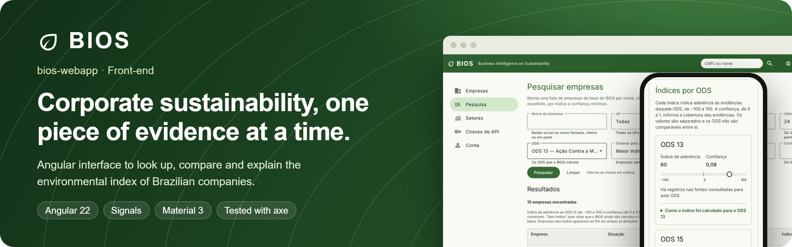
</p>

<p align="center">
  🇧🇷 <a href="README.md">Português</a> · 🇺🇸 <strong>English</strong>
</p>

<p align="center">
  <a href="https://github.com/odavibatista/bios-webapp/actions/workflows/ci.yml"></a>
  
  
  
  
</p>

<p align="center">
  <a href="#about-the-project">About</a> ·
  <a href="#screens">Screens</a> ·
  <a href="#engineering-decisions">Decisions</a> ·
  <a href="#architecture">Architecture</a> ·
  <a href="#quality">Quality</a> ·
  <a href="#quick-start">Quick start</a> ·
  <a href="#documentation">Documentation</a>
</p>

Front-end of **BIOS — Business Intelligence on Sustainability**. Starting from a CNPJ (the Brazilian
company tax ID), the app shows a company's public environmental evidence and, for **SDGs 13 and 15**,
an adherence index with a confidence level and the contribution of each piece of evidence, always
with the way back to the official source.

> **Evidence First:** no index exists without evidence traceable to the official source. Missing data
> is not negative evidence, and the index is never a sustainability verdict.

<p align="center">
  <a href="https://bios-webapp.vercel.app/"><strong>Open the demo</strong></a><br>
  <sub>Sign in with <code>apresentacao@example.com</code> and the password <code>Apresentacao2026</code>. The account only exists in the browser. The interface is in Portuguese.</sub>
</p>

<p align="center">
  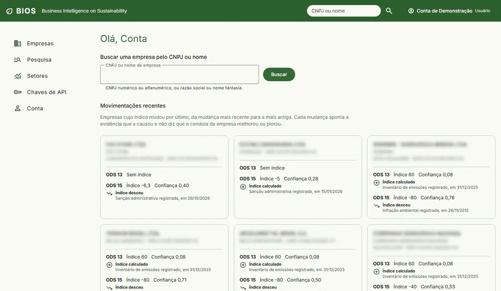
  <br>
  <sub>Real app flow: CNPJ lookup, evidence, index explanation and search by sector. The interface is in Portuguese.</sub>
</p>

## About the project

Today, anyone who wants to learn the environmental record of a Brazilian company has to check IBAMA
(the federal environmental agency), CGU (the federal comptroller), the federal revenue registry and
the Public Emissions Registry one by one, and cross-reference the results by hand. BIOS uses the CNPJ
as its axis, consolidates these sources and turns the records into explainable indicators. A sole
proprietor's public registered name may contain the owner's name; the CPF is masked, and the system
does not look up individuals' contacts or profiles.

The interface was designed not to judge companies:

- **Index and confidence stay side by side** and are never combined. A high index with low
  confidence means little evidence, and the screen says so.
- **There is no overall grade.** Each SDG has its own index, and the two are not comparable.
- **No data is not a low grade.** "No index", "No conclusive evidence" and "Could not be verified"
  are different states, with different texts.
- **An index change is not a change in conduct.** The main screen shows the direction, cause and date
  of each change, always in chronological order, never the variation or a ranking.

> **Presentation build:** the app runs without a server. The data are real responses from
> [bios-core-api](https://github.com/odavibatista/bios-core-api), captured and stored in the
> repository behind a service with the same interface as the API. The published base has 110,372
> companies, 580,166 pieces of evidence and 86 sectors, processed by the API from official files. Real
> integration means swapping only that service. A sole proprietor's public registered name may
> contain the owner's name; CPF sequences are masked. BIOS does not look up individuals' contacts
> or profiles (INL02).

## Ecosystem

<p align="center">
  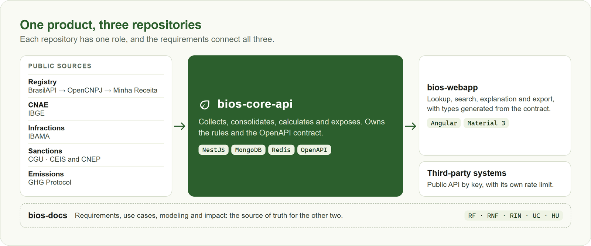
</p>

| Repository                                                     | Role                                                          |
| -------------------------------------------------------------- | ------------------------------------------------------------- |
| **bios-webapp** (you are here)                                 | Angular interface                                             |
| [bios-core-api](https://github.com/odavibatista/bios-core-api) | NestJS API: collection, consolidation, indexes and public API |
| [bios-docs](https://github.com/odavibatista/bios-docs)         | Requirements, use cases, modeling and academic documentation  |

## Screens

<table>
  <tr>
    <td colspan="2" valign="top">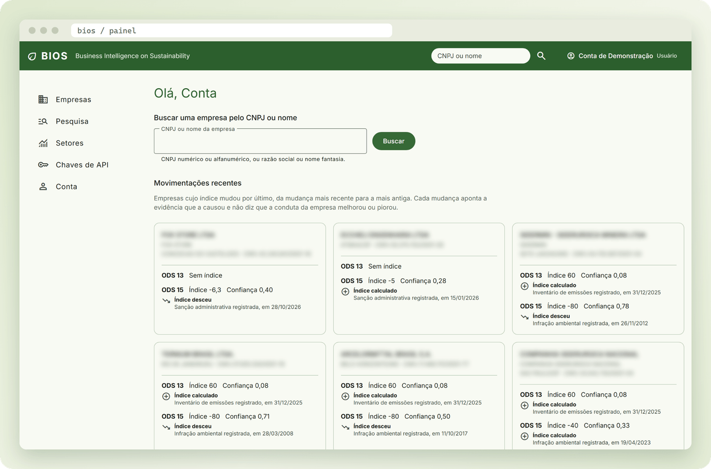</td>
  </tr>
  <tr>
    <td colspan="2" align="center"><sub><strong>Main screen:</strong> the companies whose index changed most recently, with direction, cause and date. Names are blurred in this image.</sub></td>
  </tr>
  <tr>
    <td width="50%" valign="top">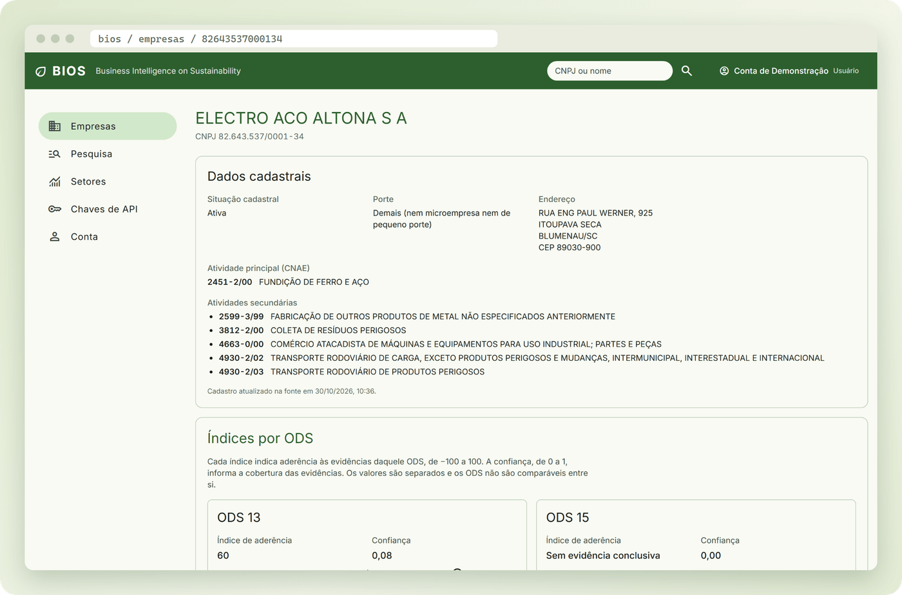</td>
    <td width="50%" valign="top">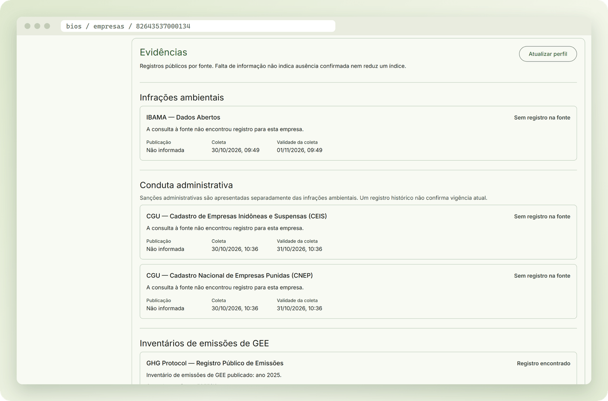</td>
  </tr>
  <tr>
    <td align="center"><sub><strong>Profile:</strong> registration data from the provider chain</sub></td>
    <td align="center"><sub><strong>Evidence:</strong> source, state, reference and collection validity</sub></td>
  </tr>
  <tr>
    <td width="50%" valign="top">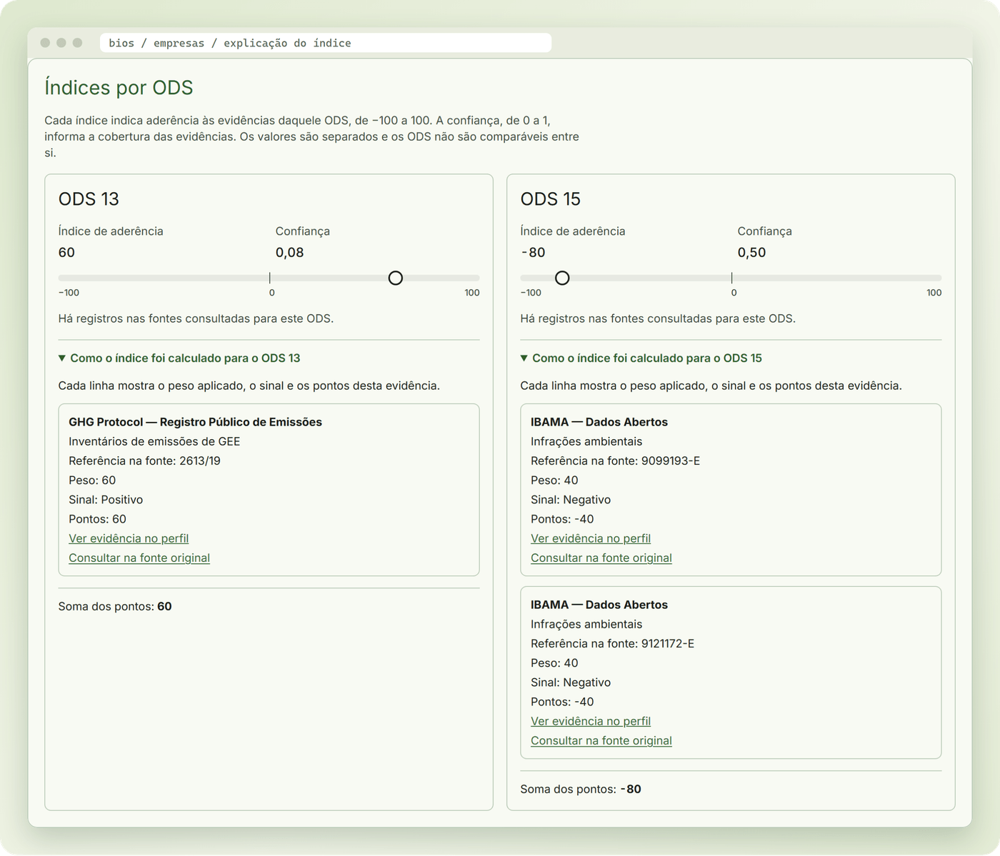</td>
    <td width="50%" valign="top">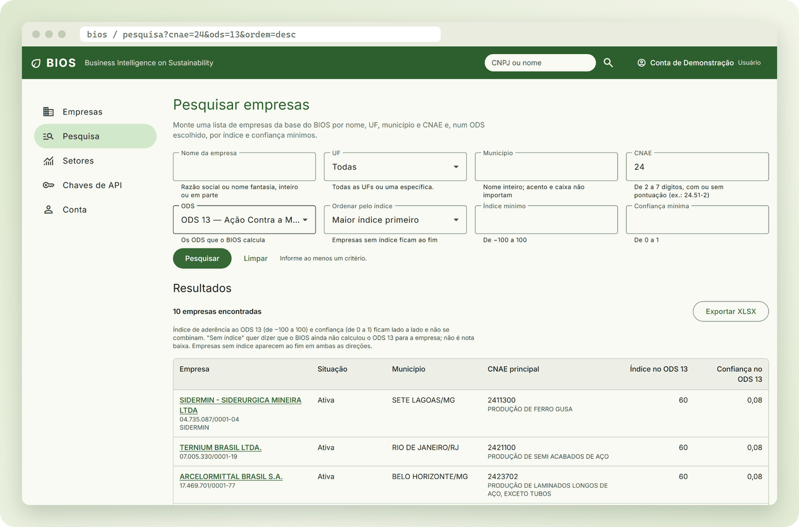</td>
  </tr>
  <tr>
    <td align="center"><sub><strong>Explanation:</strong> every index point has evidence behind it</sub></td>
    <td align="center"><sub><strong>Search:</strong> criteria in the URL, sorting by index and XLSX export</sub></td>
  </tr>
  <tr>
    <td width="50%" valign="top">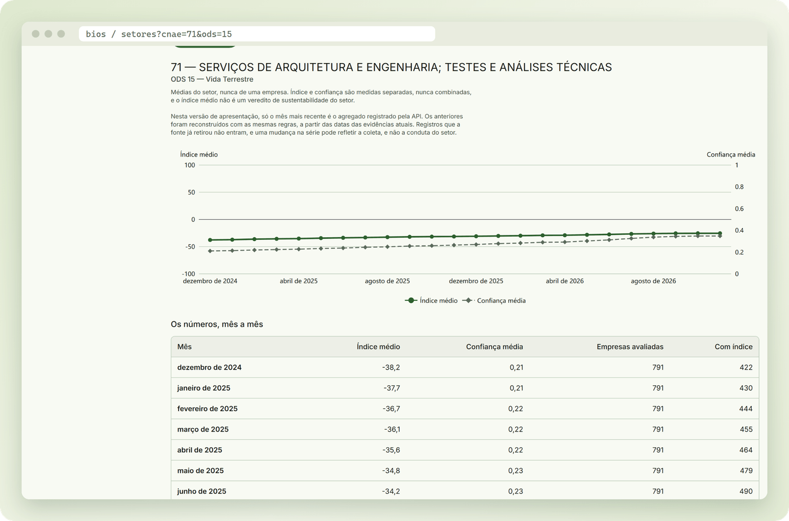</td>
    <td width="50%" valign="top">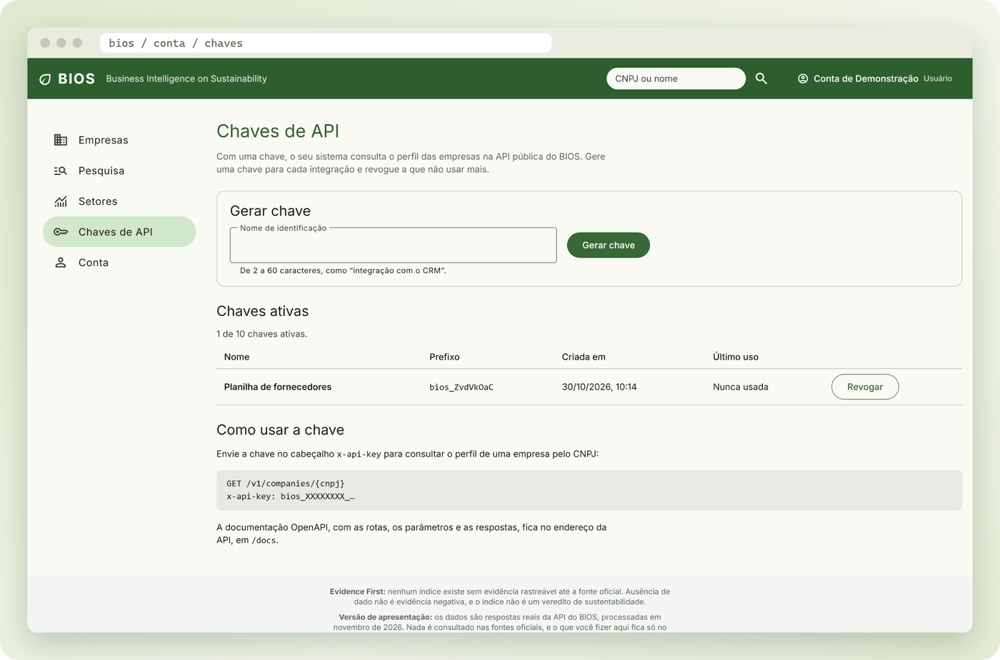</td>
  </tr>
  <tr>
    <td align="center"><sub><strong>Sectors:</strong> 24 months per sector, always aggregated, never per company</sub></td>
    <td align="center"><sub><strong>API keys:</strong> the secret appears only once</sub></td>
  </tr>
  <tr>
    <td colspan="2" valign="top">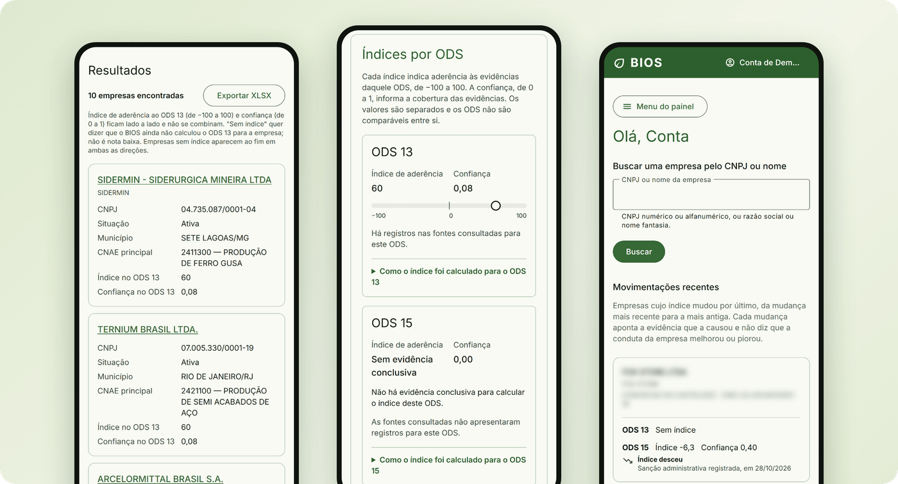</td>
  </tr>
  <tr>
    <td colspan="2" align="center"><sub><strong>Phone:</strong> tables become cards below 720 px</sub></td>
  </tr>
</table>

## Engineering decisions

| Decision                        | How it works                                                                                                                                                                                     |
| ------------------------------- | ------------------------------------------------------------------------------------------------------------------------------------------------------------------------------------------------ |
| **Contract before provider**    | Screens only know `BiosApi`, with one method per OpenAPI operation. The mock and the real client swap in a single provider, without touching any screen.                                         |
| **Real data, never made up**    | Each response is captured from the real API and checked with `satisfies` against the generated type: if the contract changes, `typecheck` rejects the old capture.                               |
| **Privacy verified by tests**   | A test walks through the captures and rejects CPFs, e-mails from other domains, JWTs and key secrets. Another checks that the site makes no request outside its own origin.                      |
| **The sum has to match**        | Across all captures, a test checks that the contributions add up to the displayed index. Another scans the screen for terms that sound like a verdict (IND01).                                   |
| **Accessibility as a gate**     | Every e2e test ends with an axe analysis (WCAG 2.0 to 2.2, levels A and AA), at 1280 and 390 px. A violation fails the test, and the error lists rule, impact and elements.                      |
| **Session without races**       | With the real API, the session lives in memory only; in the demo, it ends when the tab closes. A `401` triggers a single renewal, and concurrent calls wait for the same answer before retrying. |
| **Private route by default**    | Every route requires a session until it declares itself public, and admin routes ask for the right role. Forgetting to protect a screen does not expose it.                                      |
| **The URL holds the state**     | Search criteria, order and page live in the URL: the link can be shared and the browser's back button redoes the previous search. The main screen page follows the same rule.                    |
| **Bundle with a budget**        | The build fails above 1 MB of initial code. Captures, charts and the account menu load on demand, and the initial bundle transfers 133 kB.                                                       |
| **Portuguese as a requirement** | A test reads the templates and rejects text without accents. Fonts and icons are served by the app itself, so the presentation works offline.                                                    |

## Architecture

<p align="center">
  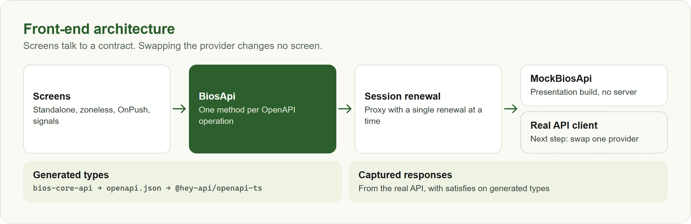
</p>

The code follows modern Angular across the whole app: standalone components, no `zone.js`, `OnPush`
change detection and state in signals. Details in [02. Architecture](docs/en/02-Architecture.md).

## Quality

| Measure         | Result                                                                    |
| --------------- | ------------------------------------------------------------------------- |
| Unit tests      | **741** with Vitest and Testing Library                                   |
| E2e tests       | **140** Playwright runs, on desktop (1280 px) and phone (390 px)          |
| Coverage        | **98.43%** of lines and **94.38%** of branches (required minimum: 75%)    |
| Initial bundle  | **133 kB** transferred (build estimate)                                   |
| Accessibility   | axe in every e2e test, failing on violations                              |
| Automatic gates | Lint on commit, Conventional Commits, CI with types, tests, build and e2e |

## Stack

| Layer           | Technology                                                                                  |
| --------------- | ------------------------------------------------------------------------------------------- |
| Runtime         | Node.js 22.23.4 and npm 11, pinned by Volta                                                 |
| Framework       | Angular 22 (standalone, zoneless, signals), TypeScript 6 `strict` with `strictTemplates`    |
| Components      | Angular Material 3 and CDK, with a theme generated from the BIOS palette                    |
| Charts          | ECharts (`ngx-echarts`)                                                                     |
| Fonts and icons | Inter and Material Symbols served by the app itself                                         |
| API types       | `@hey-api/openapi-ts`, from the bios-core-api OpenAPI document                              |
| Unit tests      | Vitest (Angular builder) and `@testing-library/angular`                                     |
| E2e tests       | Playwright (Chromium) and axe                                                               |
| Quality         | Angular ESLint with typed lint, Prettier, Husky, lint-staged, commitlint and GitHub Actions |

## Quick start

```bash
npm install          # dependencies (with Volta, the right Node and npm come by themselves)
npm start            # http://localhost:4200
```

Sign in with `apresentacao@example.com` and the password `Apresentacao2026`. To see the admin area,
use `administracao@example.com` with the same password. These are demo accounts that only exist in
the browser.

```bash
npm run verify       # types, lint, tests with coverage and build: what the CI requires
npm run test:e2e     # e2e in Playwright (first: npx playwright install chromium)
```

## Documentation

The technical manual lives in [`docs/en/`](docs/en/README.md) (and, in Portuguese, in
[`docs/`](docs/README.md)):

| No. | Chapter                                                      | Content                                           |
| --- | ------------------------------------------------------------ | ------------------------------------------------- |
| 01  | [Getting started](docs/en/01-Getting-Started.md)             | Scripts, API types and Windows paths              |
| 02  | [Architecture](docs/en/02-Architecture.md)                   | Data layer, session, panel and screen states      |
| 03  | [Accounts and access](docs/en/03-Accounts-and-Access.md)     | Sign-up, login, password, account, keys and admin |
| 04  | [Companies and indexes](docs/en/04-Companies-and-Indexes.md) | Profile, evidence, indexes, search and sectors    |
| 05  | [Presentation data](docs/en/05-Presentation-Data.md)         | Capturing and checking the API responses          |
| 06  | [Quality and tests](docs/en/06-Quality-and-Tests.md)         | Accessibility, accents and contribution flow      |
| 07  | [Theme and publishing](docs/en/07-Theme-and-Publishing.md)   | Material 3 palette and publishing on Vercel       |

## Academic context

BIOS is the individual project of Assessment 3 of the Software Engineering and Software Management
and Quality courses, in the Computer Science program at Universidade São Judas Tadeu (USJT), Brazil,
in 2026. Requirements, use cases and modeling are in
[bios-docs](https://github.com/odavibatista/bios-docs) (in Portuguese).

**Author:** Davi Deosmar Batista Oliveira Miranda · [GitHub](https://github.com/odavibatista) · [LinkedIn](https://www.linkedin.com/in/odavibatista/)

## License

© 2026 Davi Deosmar Batista Oliveira Miranda. All rights reserved. This repository is public for
reference and academic assessment; copying, modifying, distributing or using the material requires the
author's permission. See [LICENSE](LICENSE).
