<p align="center">
  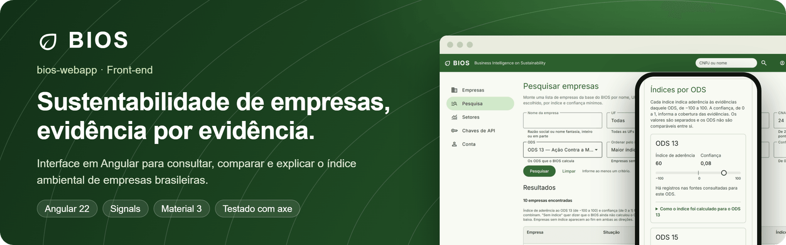
</p>

<p align="center">
  🇧🇷 <strong>Português</strong> · 🇺🇸 <a href="README.en.md">English</a>
</p>

<p align="center">
  <a href="https://github.com/odavibatista/bios-webapp/actions/workflows/ci.yml"></a>
  
  
  
  
</p>

<p align="center">
  <a href="#sobre-o-projeto">Sobre</a> ·
  <a href="#telas">Telas</a> ·
  <a href="#decisões-de-engenharia">Decisões</a> ·
  <a href="#arquitetura">Arquitetura</a> ·
  <a href="#qualidade">Qualidade</a> ·
  <a href="#início-rápido">Início rápido</a> ·
  <a href="#documentação">Documentação</a>
</p>

Front-end do **BIOS — Business Intelligence on Sustainability**. A partir de um CNPJ, o app mostra as
evidências ambientais públicas de uma empresa e, para os **ODS 13 e 15**, um índice de aderência com
nível de confiança e a contribuição de cada evidência, sempre com o caminho de volta à fonte oficial.

> **Evidence First:** nenhum índice existe sem evidência rastreável até a fonte oficial. Ausência de
> dado não é evidência negativa, e o índice nunca é um veredito de sustentabilidade.

<p align="center">
  <a href="https://bios-webapp.vercel.app/"><strong>Abrir a demonstração</strong></a><br>
  <sub>Entre com <code>apresentacao@example.com</code> e a senha <code>Apresentacao2026</code>. A conta só existe no navegador.</sub>
</p>

<p align="center">
  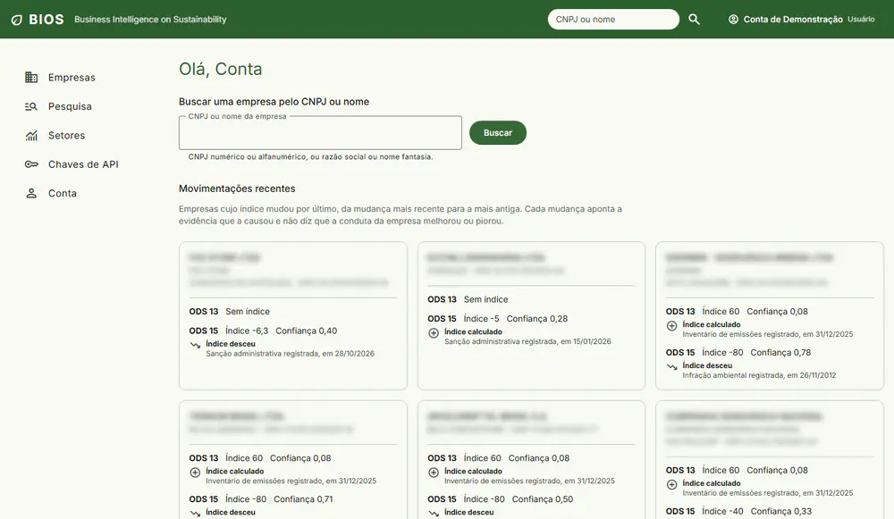
  <br>
  <sub>Fluxo real do app: consulta por CNPJ, evidências, explicação do índice e pesquisa por setor.</sub>
</p>

## Sobre o projeto

Quem quer conhecer o histórico ambiental de uma empresa brasileira hoje consulta IBAMA, CGU, Receita
Federal e o Registro Público de Emissões separadamente e cruza os resultados por conta própria. O
BIOS usa o CNPJ como eixo, consolida essas fontes e transforma os registros em indicadores
explicáveis. A razão social pública de empresário individual pode conter o nome do titular; o
CPF é mascarado e o sistema não busca contatos nem perfis de pessoas físicas.

A interface foi desenhada para não julgar empresas:

- **Índice e confiança ficam lado a lado** e nunca se combinam. Índice alto com confiança baixa quer
  dizer poucas evidências, e a tela mostra isso.
- **Não existe nota geral.** Cada ODS tem o seu índice, e os dois não são comparáveis entre si.
- **Sem dado não é nota baixa.** "Sem índice", "Sem evidência conclusiva" e "Não foi possível
  verificar" são estados diferentes, com textos diferentes.
- **Mudança de índice não é mudança de conduta.** A tela principal mostra o sentido, a causa e a data
  de cada mudança, sempre em ordem cronológica, nunca a variação ou um ranking.

> **Versão de apresentação:** o app roda sem servidor. Os dados são respostas reais do
> [bios-core-api](https://github.com/odavibatista/bios-core-api), capturadas e guardadas no
> repositório atrás de um serviço com a mesma interface da API. A base publicada tem 110.372
> empresas, 580.166 evidências e 86 setores, processados pela API a partir de arquivos oficiais.
> Integrar de verdade é trocar só esse serviço. A razão social pública de empresários individuais
> pode conter o nome do titular; sequências de CPF são mascaradas. O BIOS não busca contatos nem
> perfis de pessoas físicas (INL02).

## Ecossistema

<p align="center">
  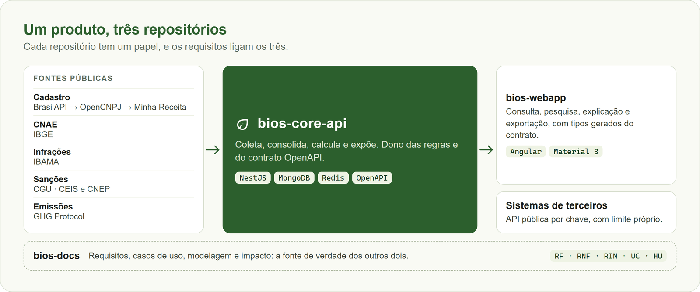
</p>

| Repositório                                                    | Papel                                                        |
| -------------------------------------------------------------- | ------------------------------------------------------------ |
| **bios-webapp** (você está aqui)                               | Interface em Angular                                         |
| [bios-core-api](https://github.com/odavibatista/bios-core-api) | API em NestJS: coleta, consolidação, índices e API pública   |
| [bios-docs](https://github.com/odavibatista/bios-docs)         | Requisitos, casos de uso, modelagem e documentação acadêmica |

## Telas

<table>
  <tr>
    <td colspan="2" valign="top">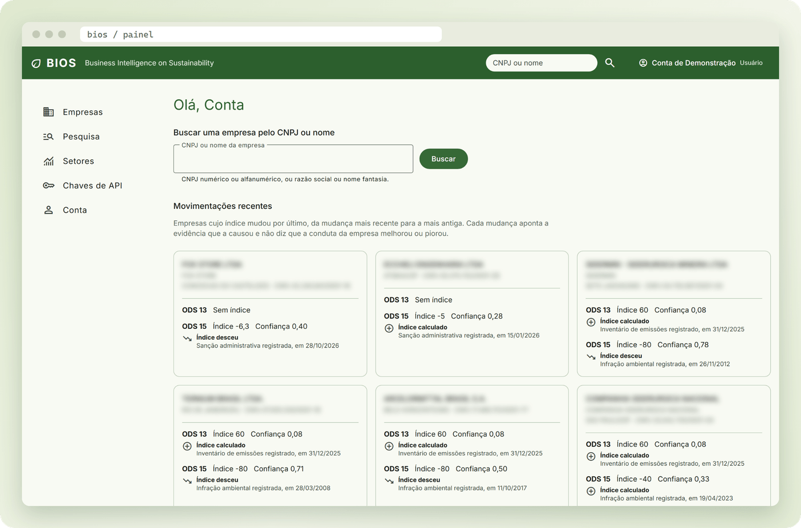</td>
  </tr>
  <tr>
    <td colspan="2" align="center"><sub><strong>Tela principal:</strong> as empresas cujo índice mudou por último, com sentido, causa e data. Os nomes estão borrados nesta imagem.</sub></td>
  </tr>
  <tr>
    <td width="50%" valign="top">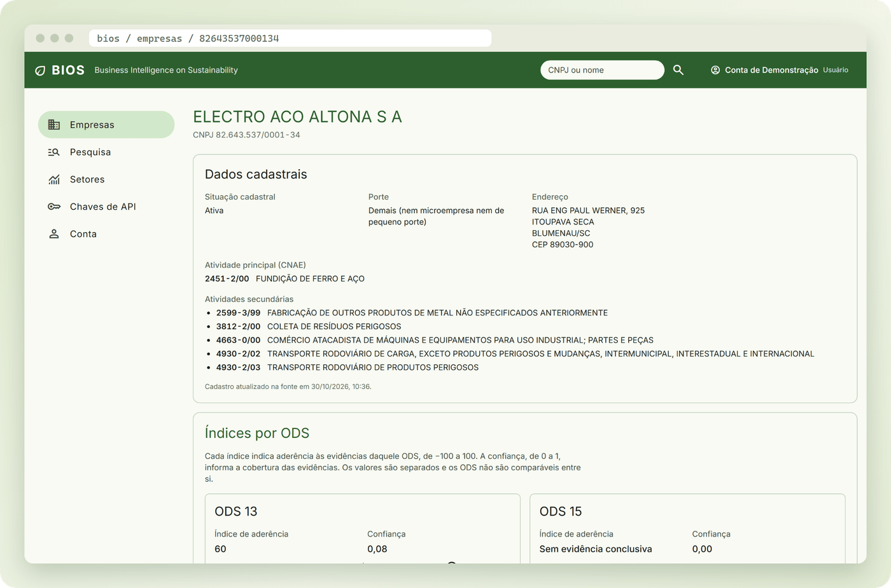</td>
    <td width="50%" valign="top">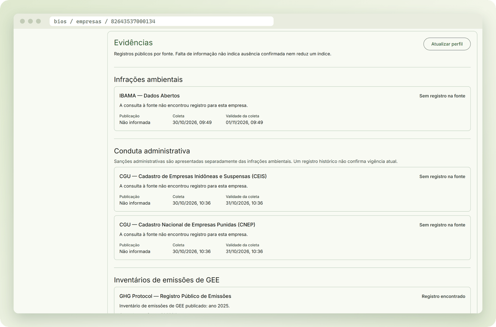</td>
  </tr>
  <tr>
    <td align="center"><sub><strong>Perfil:</strong> dados cadastrais vindos da cadeia de provedores</sub></td>
    <td align="center"><sub><strong>Evidências:</strong> fonte, estado, referência e validade da coleta</sub></td>
  </tr>
  <tr>
    <td width="50%" valign="top">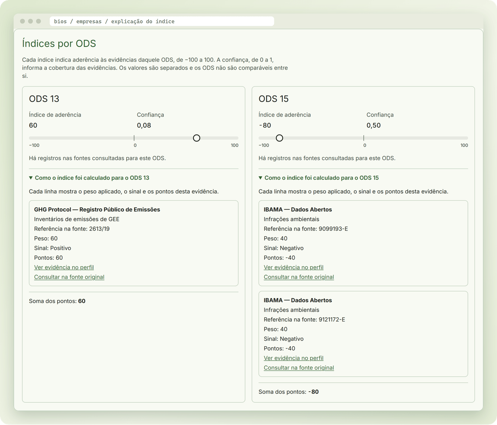</td>
    <td width="50%" valign="top">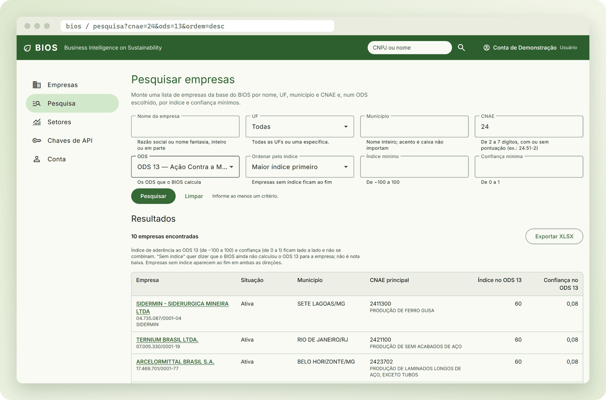</td>
  </tr>
  <tr>
    <td align="center"><sub><strong>Explicação:</strong> cada ponto do índice tem uma evidência por trás</sub></td>
    <td align="center"><sub><strong>Pesquisa:</strong> critérios na URL, ordenação pelo índice e exportação em XLSX</sub></td>
  </tr>
  <tr>
    <td width="50%" valign="top">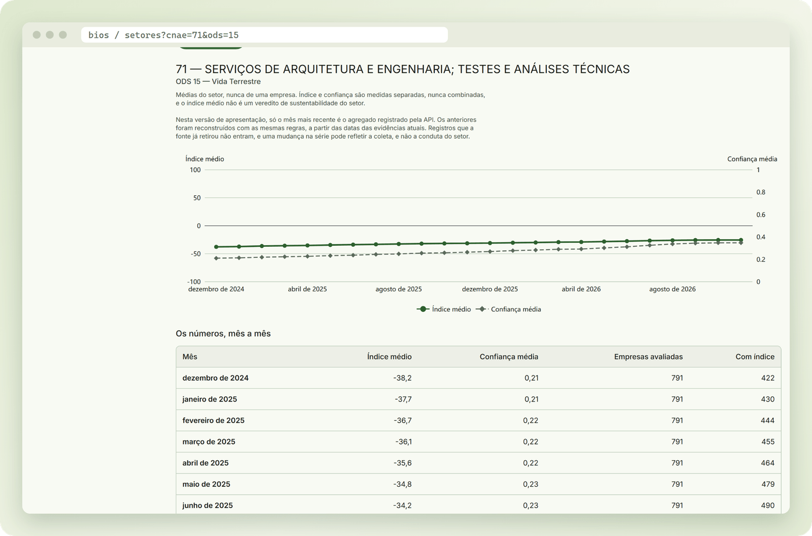</td>
    <td width="50%" valign="top">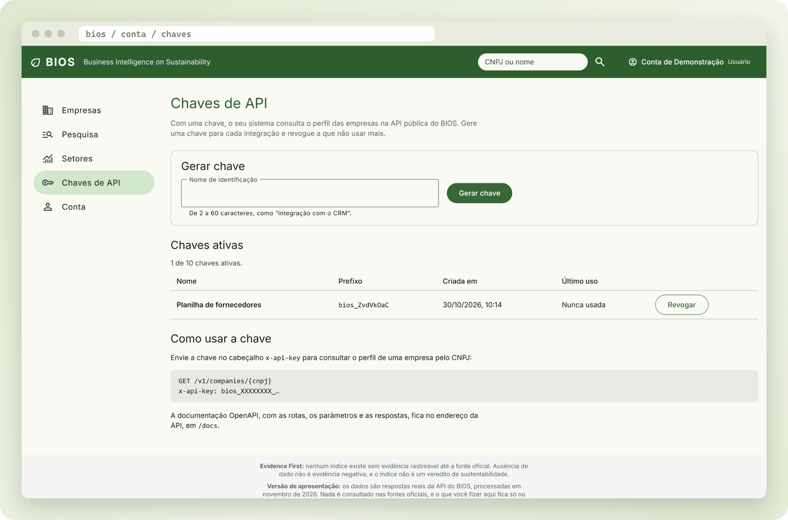</td>
  </tr>
  <tr>
    <td align="center"><sub><strong>Setores:</strong> 24 meses por setor, sempre agregados, nunca por empresa</sub></td>
    <td align="center"><sub><strong>Chaves de API:</strong> o segredo aparece uma única vez</sub></td>
  </tr>
  <tr>
    <td colspan="2" valign="top">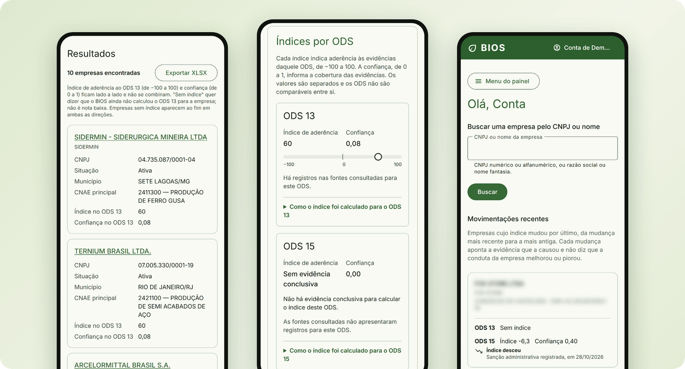</td>
  </tr>
  <tr>
    <td colspan="2" align="center"><sub><strong>Celular:</strong> tabelas viram cartões abaixo de 720 px</sub></td>
  </tr>
</table>

## Decisões de engenharia

| Decisão                             | Como funciona                                                                                                                                                                                                  |
| ----------------------------------- | -------------------------------------------------------------------------------------------------------------------------------------------------------------------------------------------------------------- |
| **Contrato antes do provedor**      | As telas só conhecem `BiosApi`, com um método por operação do OpenAPI. Mock e cliente real são trocados em um único provedor, sem tocar em nenhuma tela.                                                       |
| **Dado real, nunca inventado**      | Cada resposta é capturada da API real e validada com `satisfies` sobre o tipo gerado: se o contrato mudar, o `typecheck` recusa a captura antiga.                                                              |
| **Privacidade verificada em teste** | Um teste percorre as capturas e reprova CPF, e-mail de outro domínio, JWT e segredo de chave. Outro confere que o site não faz nenhuma requisição fora da própria origem.                                      |
| **A soma tem que fechar**           | Em todas as capturas, um teste confere que a soma das contribuições é igual ao índice exibido. Outro varre a tela atrás de termos que soem como veredito (IND01).                                              |
| **Acessibilidade como barreira**    | Todo teste e2e termina com a análise do axe (WCAG 2.0 a 2.2, níveis A e AA), em 1280 e 390 px. Uma violação reprova o teste, e o erro lista regra, impacto e elementos.                                        |
| **Sessão sem corrida**              | Com a API real, a sessão fica só em memória; na demonstração, ela acaba ao fechar a aba. Um `401` dispara uma única renovação, e as chamadas simultâneas esperam a mesma resposta antes de repetir a operação. |
| **Rota privada por padrão**         | Toda rota exige sessão até se declarar pública, e as rotas de administração pedem o papel certo. Esquecer de proteger uma tela não abre a tela.                                                                |
| **A URL guarda o estado**           | Critérios, ordem e página da pesquisa moram na URL: o link é compartilhável e o "voltar" do navegador refaz a pesquisa anterior. A página da tela principal segue a mesma regra.                               |
| **Bundle com orçamento**            | O build falha acima de 1 MB iniciais. Capturas, gráficos e menu da conta carregam sob demanda, e o bundle inicial transfere 133 kB.                                                                            |
| **Português como requisito**        | Um teste lê os templates e reprova texto sem acento. Fontes e ícones são servidos pelo próprio app, então a apresentação funciona offline.                                                                     |

## Arquitetura

<p align="center">
  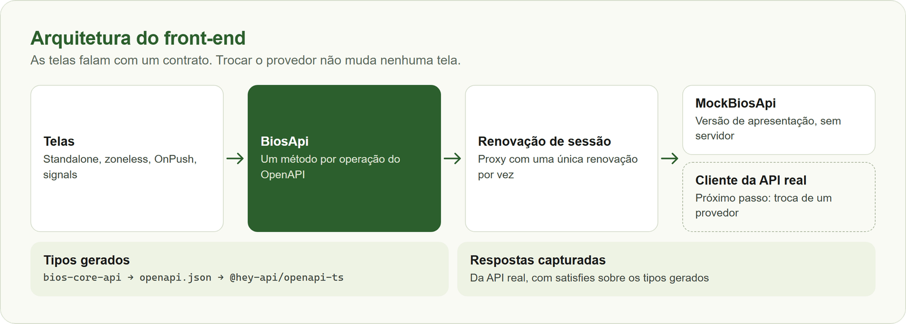
</p>

O código segue Angular moderno em todo o app: componentes standalone, sem `zone.js`, com detecção
`OnPush` e estado em signals. Detalhes em [02. Arquitetura](docs/02-Arquitetura.md).

## Qualidade

| Medida                | Resultado                                                                |
| --------------------- | ------------------------------------------------------------------------ |
| Testes unitários      | **741** com Vitest e Testing Library                                     |
| Testes e2e            | **140** execuções no Playwright, em desktop (1280 px) e celular (390 px) |
| Cobertura             | **98,43%** das linhas e **94,38%** dos ramos (mínimo exigido: 75%)       |
| Bundle inicial        | **133 kB** transferidos (estimativa do build)                            |
| Acessibilidade        | axe em todo teste e2e, com reprovação por violação                       |
| Barreiras automáticas | Lint no commit, Conventional Commits, CI com tipos, testes, build e e2e  |

## Stack

| Camada           | Tecnologia                                                                                   |
| ---------------- | -------------------------------------------------------------------------------------------- |
| Runtime          | Node.js 22.23.4 e npm 11, fixados pelo Volta                                                 |
| Framework        | Angular 22 (standalone, zoneless, signals), TypeScript 6 `strict` com `strictTemplates`      |
| Componentes      | Angular Material 3 e CDK, com tema gerado da paleta do BIOS                                  |
| Gráficos         | ECharts (`ngx-echarts`)                                                                      |
| Fontes e ícones  | Inter e Material Symbols servidos pelo próprio app                                           |
| Tipos da API     | `@hey-api/openapi-ts`, a partir do OpenAPI do bios-core-api                                  |
| Testes unitários | Vitest (builder do Angular) e `@testing-library/angular`                                     |
| Testes e2e       | Playwright (Chromium) e axe                                                                  |
| Qualidade        | Angular ESLint com lint por tipos, Prettier, Husky, lint-staged, commitlint e GitHub Actions |

## Início rápido

```bash
npm install          # dependências (com o Volta, Node e npm certos entram sozinhos)
npm start            # http://localhost:4200
```

Entre com `apresentacao@example.com` e a senha `Apresentacao2026`. Para ver a administração, use
`administracao@example.com`, com a mesma senha. São contas de demonstração, que só existem no
navegador.

```bash
npm run verify       # tipos, lint, testes com cobertura e build: o que o CI exige
npm run test:e2e     # e2e no Playwright (antes: npx playwright install chromium)
```

## Documentação

O manual técnico fica em [`docs/`](docs/README.md) (e, em inglês, em [`docs/en/`](docs/en/README.md)):

| Nº  | Capítulo                                                            | Conteúdo                                              |
| --- | ------------------------------------------------------------------- | ----------------------------------------------------- |
| 01  | [Como rodar](docs/01-Como-Rodar.md)                                 | Scripts, tipos da API e caminhos no Windows           |
| 02  | [Arquitetura](docs/02-Arquitetura.md)                               | Camada de dados, sessão, painel e estados de tela     |
| 03  | [Contas e acesso](docs/03-Contas-e-Acesso.md)                       | Cadastro, login, senha, conta, chaves e administração |
| 04  | [Empresas e índices](docs/04-Empresas-e-Índices.md)                 | Perfil, evidências, índices, pesquisa e setores       |
| 05  | [Dados da versão de apresentação](docs/05-Dados-de-Apresentação.md) | Captura e conferência das respostas da API            |
| 06  | [Qualidade e testes](docs/06-Qualidade-e-Testes.md)                 | Acessibilidade, acentuação e fluxo de contribuição    |
| 07  | [Tema e publicação](docs/07-Tema-e-Publicação.md)                   | Paleta do Material 3 e publicação na Vercel           |

## Contexto acadêmico

O BIOS é o projeto individual da Avaliação 3 das disciplinas de Engenharia de Software e de Gestão e
Qualidade de Software, do curso de Ciência da Computação da Universidade São Judas Tadeu (USJT), em 2026. Requisitos, casos de uso e modelagem estão no
[bios-docs](https://github.com/odavibatista/bios-docs).

**Autor:** Davi Deosmar Batista Oliveira Miranda · [GitHub](https://github.com/odavibatista) · [LinkedIn](https://www.linkedin.com/in/odavibatista/)

## Licença

© 2026 Davi Deosmar Batista Oliveira Miranda. Todos os direitos reservados. Este repositório é
público para consulta e avaliação acadêmica; copiar, modificar, distribuir ou usar o material depende
de autorização do autor. Veja [LICENSE](LICENSE).
